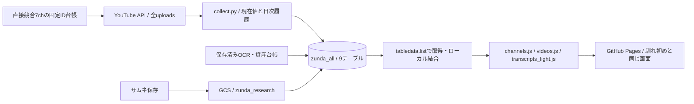

# ずんだもん：取得・保存・表示の構成

公開サイト：https://japonismy.github.io/zunda-kikaku-research/

これは馴れ初め側の「取得→BigQueryで現在値と履歴を保管→資産を動画IDで結合→静的JS生成→GitHub Pages表示」を移植する実装。表示だけの前回版を置き換える。

2026-11-02現在、無料の取得・ローカル保存・画面移植・接続コード・テストは完了。**BigQueryへの実データ登録、GCSへのアップロード、Cloud Run / Schedulerの作成・稼働は未実行**。新規費用の承認が必要なため、公開画面にも未接続と表示する。

## 馴れ初め本番の確認結果

- Project: `rugged-destiny-408613`。作業アカウント `japonismy@gmail.com` を確認。
- `naresome_all.channels` を監視台帳とするCloud Run Job `naresome-daily-metadata`。
- Cloud Schedulerは毎日03:20 JSTに有効。channels / videosをYouTube APIから取得し、channel_snapshots / video_snapshotsを追加・更新。
- サムネOCRはthumbnail_ocr、画像保全はthumbnail_assets、字幕・台本CSVはscript_assetsに動画IDで登録。
- BigQueryからサイト用のchannels.js / videos.js / transcripts_light.jsを生成。馴れ初め版はSQLで結合し、現行・保全・過去調査・前回公開スナップショットを統合。
- GitHub Actionsは03:50 JSTにサイト用データを再生成。ページ表示時はBQへ直接問い合わせず、公開用の静的JSを読む。
- サムネはGCSの保全画像を優先し、YouTube画像へフォールバック。CSV資産は登録URLへリンク。
- メタデータGET/LISTのみで本番構成を確認。既存本番にSQL・設定変更・生成処理を送っていない。

## ずんだもん版



`backend/config.json` が対象台帳。馴れ初めデータセットにずんだもん動画を混ぜず、`zunda_all` と `zunda_research/` の専用領域を使う。DBスキーマは本番のメタデータから継承した。

|テーブル|保存するもの|
|---|---|
|channels|チャンネルID、ハンドル、公開名、登録者、動画数、監視区分|
|videos|タイトル、概要欄、公開日、尺、再生数、高評価、コメント、タグ|
|channel_snapshots|チャンネルの日次履歴|
|video_snapshots|動画の日次履歴|
|videos_archive|明示的に取り込んだ保全動画|
|thumbnail_assets|保存画像の動画ID・GCS URI・サイズ・取得エラー|
|thumbnail_ocr|保存済みOCRと将来の追加OCRの格納先|
|script_assets|既存の字幕・台本CSV資産の格納先|
|youtube_metadata_update_runs|日次実行の結果|

全uploadsをページ末尾まで列挙。APIは最大180リクエスト、動画は最大3,000本、同じ条件の自動再試行なし。同日取得済みメタデータを再利用し、次の日付は新規取得する。
ローカルミラーは `data_sources/warehouse/*.json`。同じ日・動画IDの履歴は重複させない。動画がYouTube APIから返らなくなっても最後の実測値を消さない。

馴れ初め版との差分は、公開用データの結合をローカルPythonで行い、BigQueryの読み出しに `list_rows` を使う点。保存先・履歴・資産結合・表示データの契約を揃えつつ、サイト再生成ごとの課金SQLを避ける。

概要欄ダイジェストは字幕と区別する。実在する字幕・台本資産がない動画を「台本あり」と表示しない。高評価やコメントが取得不能なら0ではなく未取得として保持。

## 実行順序

無料のローカル処理:

```powershell
python .\backend\collect.py
python .\backend\import_existing.py
python .\backend\archive_thumbnails.py
python .\backend\build_portal.py
python .\backend\cloud_sync.py
python -m unittest discover -s tests -p 'test_pipeline.py' -v
node .\tests\portal_browser_test.js
```

collect.pyは同日の取得原本が存在する場合は再利用する。APIキーは環境変数YOUTUBE_API_KEY。キーをサイト・Gitへ書かない。
`cloud_sync.py`の引数なし実行はローカルの登録計画の生成だけ。`--push` は承認ファイルなしではGoogle SDKの初期化前に拒否する。`--pull` はBigQueryの無料プレビュー読み出しで、SQLジョブを作らない。

課金範囲と上限を明示承認後の反映順序:

1. 選択アカウント、リージョン、サービスアカウント、既存バケットの保存クラス・権限・ソフト削除設定を確認し、見積条件と照合。
2. `cost_approval.example.json`とは別に、実際の承認根拠・期間・件数・上限を持つ非公開ファイルを作る。サンプルのfalseを機械的にtrueへ変えて実行しない。
3. 承認パスをZUNDA_COST_APPROVAL_FILEへ指定。`cloud_sync.py --push` で専用datasetと9テーブルに現在の保存値を登録。
4. `upload_assets.py` で同じバイトのサムネをGCSへ保全。SHA256、オブジェクトgeneration、アップロード済みファイルの再利用を確認。既存バケットのIAMを変更しない。
5. 再度 `cloud_sync.py --push` で資産URIを登録し、`--pull` →build_portal.pyでDBから生成できることを確認。
6. Cloud Build 1回・20分上限、Cloud Run 1タスク・1CPU・512MiB・600秒・再試行0のジョブを反映。Schedulerは作成後停止し、承認範囲内だけ有効化。
7. 日次取得は03:20 JST、サイト側再生成は03:50 JST。update-data.ymlには現在cronを書いていない。実稼働と費用の承認後に追加する。

Google SDKの依存はbackend/requirements.txt。ローカルはdata_sources/.venvに導入済み。BigQuery/GCSクライアントのimportと、9テーブル・7,281行のSDK形式への変換を課金なしで確認した。Cloud RunとGitHub Actionsは同ファイルで導入する。
公開用ページにDB資格情報は置かない。原本・履歴ミラー・承認・実行レポートは公開対象外。

## 現在の不足と費用承認の対象

- BigQueryの実データ保存と日次クラウドジョブは未接続。画面の表示成功をDB接続成功と扱わない。
- サムネのローカル保存は完了。GCS転送および公開保全URLの疎通確認は未実行。
- OCRは既存69件を再利用。追加OCRや生成AIは未承認・未実行。script_assetsは受け皿のみで、保存字幕を新たに生成したわけではない。
- GCS公開配信を行う場合は転送量に応じた費用が増える。今回の300円の案は保存と日次取得・静的データ生成までで、無制限の画像配信を含まない。公開画像の保全URLを有効化する前に、配信方式・転送量上限を確定する。
- 30日分の承認案。期限後の計算処理を続けない。保存費・Scheduler・Artifact Registry等は停止だけではゼロにならないため、継続保存と定期ジョブの維持／削除方針も承認時に確定する。

現時点の追加課金は0円。クラウドへの有料反映と稼働を完了したとは報告しない。
