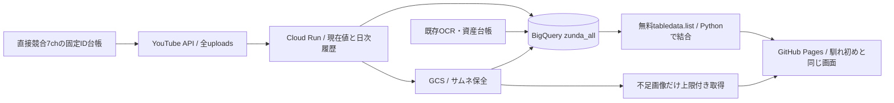

# 取得・保存・表示の運用

2026-11-02に本番接続済み。公開サイト：https://japonismy.github.io/zunda-kikaku-research/

## 馴れ初めから移植した範囲

馴れ初めはnaresome_allのチャンネル台帳を基に、毎日03:20 JSTにCloud RunでYouTubeを取得する。現在値・日次履歴、OCR、サムネ・字幕資産を動画IDで結合し、03:50 JSTのGitHub Actionsで静的JSを生成して表示する。

ずんだもんは同じ構成を専用dataset `zunda_all`、専用GCS prefix `zunda_research/` へ実装。元の馴れ初めテーブルやジョブは変更していない。



読み出しと結合はBigQuery SQLではなく無料のtabledata.listとローカルPython。BQ処理費を発生させず、DBを永続保存先とする。公開ページは静的JSと画像を読むため、閲覧時のBQクエリはない。

## 本番の識別子

- Project：rugged-destiny-408613
- Dataset：zunda_all / asia-northeast1
- Cloud Run Job：zunda-daily-metadata
- Scheduler：zunda-daily-metadata-schedule / 03:20 JST
- GitHub Actions：update-data.yml / 03:50 JST
- GCS：gs://senior-share-staging-570862915709/zunda_research/thumbnails/
- 公開画像：assets/thumbnails/{video_id}.jpg（GitHub Pages）
- Runner：zunda-research-runner。DB書き込みと専用GCS prefixだけに権限を限定。
- Reader：zunda-site-reader。DB・専用画像の読み取り。GitHub mainブランチに限定した鍵なし認証。

config.jsonが対象7chの正本。Japan応援隊／じゃぱん応援隊は対象外。

## 保存ルール

channelsとvideosは現在値。channel_snapshotsとvideo_snapshotsは日付・自然キーで冪等に保存。動画が返らなくなっても最後の値を消さない。videos_archiveは明示保全用。thumbnail_ocrは既存69件を再利用。thumbnail_assetsはGCS URIとサイズ、script_assetsは既存字幕・台本資産の受け皿。youtube_metadata_update_runsは実行履歴。

高評価やコメントが取得できなければ0に置き換えない。概要欄ダイジェストは台本・字幕と区別する。サムネの高解像度URLで失敗した3件は、HQ URLへ取得先を変えて一度だけ補完し、全2,274件を保全した。

## 実行制限と費用

承認：初期構築＋30日、総額300円以内。2026-11-02〜2026-12-01。有料OCR・生成AI・追加クレジットは未承認・未使用。

- API：180 listリクエスト以内、動画3,000本以内、同一条件の自動再試行なし。
- BQ：JSON換算50MiB以内。課金SQL・Storage Read APIは使わない。
- GCS：保存1GiB・3,000オブジェクト以内。公開ページからGCS画像を直接配信しない。
- 差分画像の読出し：1回20枚・1MiB/枚・期間合計600MiB以内。取得前に予約バイト数を記録。
- Cloud Run：最大30実行（初回実測を含む）、1CPU・512MiB・600秒、再試行0。
- Pages：画像800MiB以内。デプロイ成功後は一時artifactを直ちに削除。
- 最終日成功時に専用Schedulerを削除。期間終了後はサイト再生成workflowも自己停止。

reports/cost_ledger.jsonが承認と予約の台帳。実請求は未確定であり、予約上限を実際の支払額と呼ばない。保管物は更新停止だけでは保存費がゼロにならない。期間延長時は承認・実績・残予算・保管方針を読み直す。

## 手動で表示データだけ再生成

```powershell
& '.\data_sources\.venv\Scripts\python.exe' backend\cloud_sync.py --pull
& '.\data_sources\.venv\Scripts\python.exe' backend\build_portal.py
```

通常はGitHub Actionsを使う。collect.py --cachedや古いrefresh_direct.pyを、最新DBの更新手順として使わない。

## 検証と復旧

Cloud Run初回実行成功：zunda-daily-metadata-57rsp。
GitHubの鍵なし認証・BQ読み取り・画像差分・サイト生成・公開が成功。バックエンド9件、ヘッドレスブラウザ20項目。

失敗時は新しい有料リクエストを止め、該当実行・台帳・既存成果物を確認する。無制限に再実行・ビルド・再生成しない。画像はSHA256で一致を確認し、既に保存されたファイルを再生成しない。
